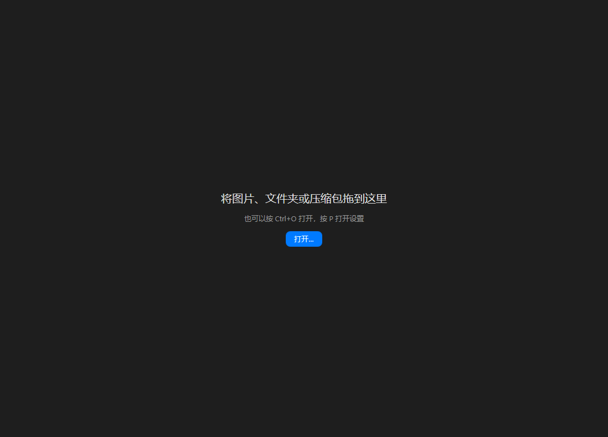
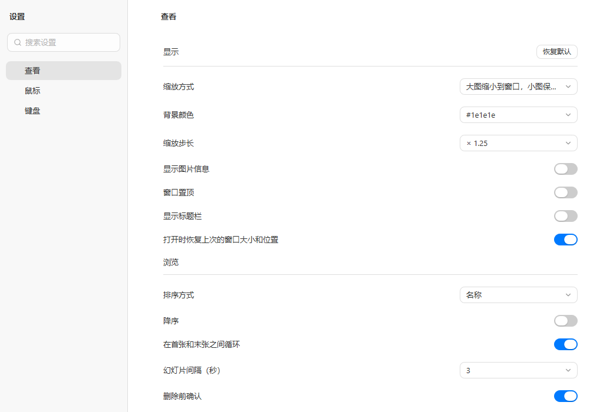

# FreeView

**An image viewer for Windows.**

[简体中文](README.md) · English

---

## Preview

  

[Main window](assets/screenshots/FreeView-main.png) · [Preferences window](assets/screenshots/FreeView-preferences.png)

## About FreeView

FreeView is an image viewer for Windows. It opens images, folders, and archives on your computer. You can look at images in an archive without extracting it first.

## What you can do

- **View images.** Open JPEG, PNG, GIF, WebP, BMP, and TIFF images. Animated GIF and WebP images play automatically.
- **Browse a folder.** Go to the previous, next, first, or last image. Start a slideshow.
- **Open an archive.** Look at images in ZIP, 7z, RAR, and TAR archives.
- **Zoom and move an image.** Zoom in, zoom out, fit the image to the window, or show the original size. If the image is larger than the window, you can drag it.
- **View an image in full screen.** Rotate or flip an image. Show image information.
- **Organize images.** Move an image to the Recycle Bin. Copy the image or its path. Show the image in File Explorer.
- **Customize the controls.** Change 13 mouse actions and the shortcut keys for each action.

## Download and start

### Install FreeView

1. Open the [FreeView download page](https://github.com/OUBIGFA/FreeView/releases).
2. Download the Windows installation file.
3. Open the downloaded file.
4. Follow the instructions on the screen to install FreeView.

The current version is 0.1.0. It runs on 64-bit Windows 10 and Windows 11.

The installer installs FreeView for your user account. You do not need administrator rights. After you install FreeView, open it from the Start menu. You can also create a desktop shortcut during installation.

The installer does not change your default apps. FreeView appears in the "Open with" list for images and archives.

To uninstall FreeView, open Settings. Select Apps. Select Installed apps. Select FreeView.

### Open an image

1. Open FreeView.
2. Drag an image, a folder, or an archive into the window. You can also press Ctrl+O and select a file.
3. Use the wheel or the arrow keys to change images.
4. Right-click to open the menu.

The window has no title bar by default. To move the window, drag the top edge of the window or the background beside the image.

### Common controls

| Action | Result |
| --- | --- |
| Wheel up or down | Previous or next image |
| Ctrl + wheel up or down | Zoom in or out |
| Hold the left button and drag | Move the image |
| Double-click the left button | Full screen |
| Right-click | Open the menu |
| P | Open Preferences |
| Alt | Show the menu bar |

## Options

- **Change mouse actions.** Open Preferences. On the Mouse page, select an action for each item.
- **Change keyboard shortcuts.** On the Keyboard page, add or remove shortcuts. Click Record. Then press a key.
- **Change the view.** On the Viewing page, select the fit mode, background color, sort order, looping, and slideshow interval.
- **Change the window display.** On the Viewing page, turn on or off "Keep the window on top" and "Show the title bar".
- **Restore the default settings.** On the Viewing page, click Restore defaults.
- **Stop FreeView from remembering the window.** On the Viewing page, turn off "Open at the last window size and position".

## Notes

- This version of the installer is not digitally signed. Windows can show an "Unknown publisher" message.
- FreeView uses one main window. If you open another image, the image appears in that window.
- You cannot delete an image inside an archive.
- Animated images play continuously. You cannot pause them or view one frame at a time.
- FreeView cannot open HEIC, AVIF, JPEG XL, RAW, ICO, and SVG images.

## Sources and license

FreeView is open-source software. It uses the [GPL-3.0-only](LICENSE) license. The source code is in the [GitHub repository](https://github.com/OUBIGFA/FreeView).

[GPL-3.0-only license](LICENSE) · [Third-party components](third_party/README.md)
