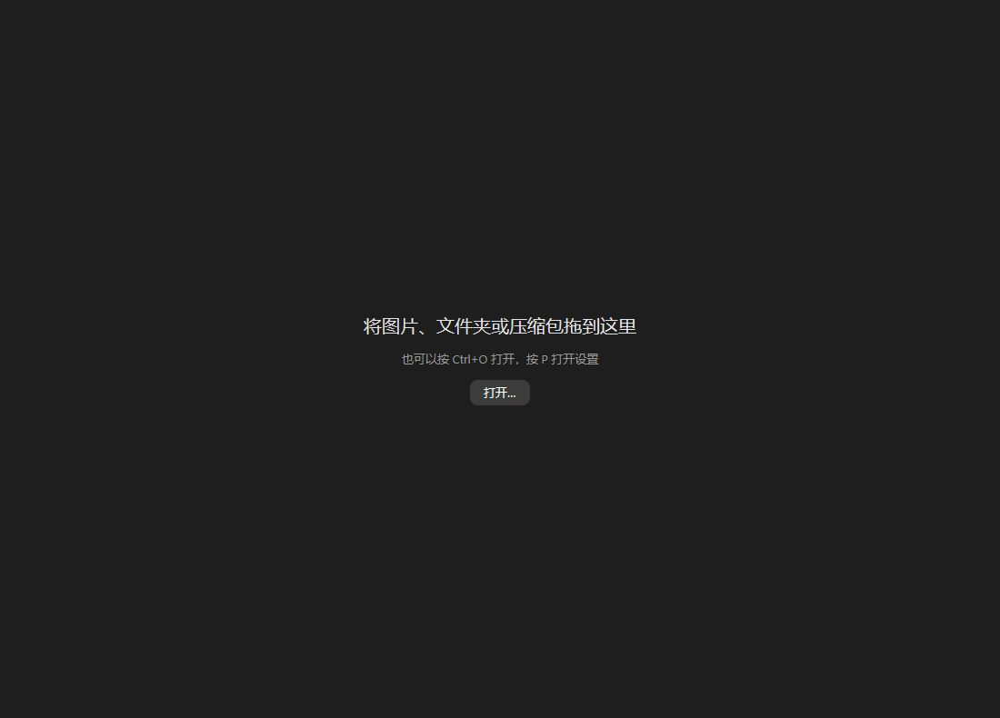
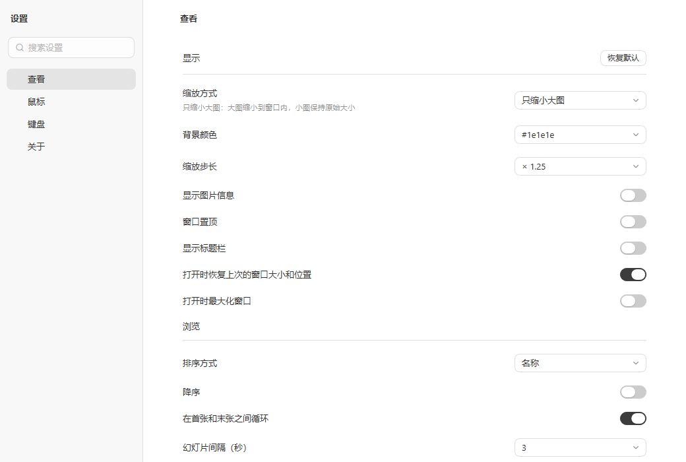

# FreeView

**用于 Windows 的图片查看应用**

简体中文 · [English](README.en.md)

---

## 界面预览

  

[主窗口原图](assets/screenshots/FreeView-main.png) · [设置窗口原图](assets/screenshots/FreeView-preferences.png)

## 项目说明

FreeView 是一个查看图片的电脑应用。它打开电脑上的图片、文件夹和压缩包。你可以直接查看压缩包中的图片，不必先解压。

## 可以用来做什么

- **查看图片。** 打开 JPEG、PNG、GIF、WebP、BMP、TIFF、SVG 和 ICO 图片。GIF 和 WebP 动画图片会自动播放。
- **查看手机和相机照片。** 打开 HEIC、AVIF、JPEG XL 和相机 RAW 照片（如 DNG、CR3、NEF、ARW）。这些格式由 Windows 解码，需要先安装对应的 Windows 扩展，见[注意](#注意)。
- **浏览文件夹。** 看上一张、下一张、第一张或最后一张图片。也可以开始幻灯片。
- **打开压缩包。** 直接查看 ZIP、7z、RAR 和 TAR 压缩包中的图片。
- **缩放和移动图片。** 放大、缩小、适应窗口或显示原始大小。图片比窗口大时，你可以拖动图片。
- **全屏查看图片。** 旋转或翻转图片。显示图片信息。
- **整理图片。** 把图片移到回收站。复制图片或路径。在文件资源管理器中显示图片。
- **自定义操作。** 更改 13 种鼠标操作和每个动作的快捷键。
- **保持最新。** FreeView 每天检查一次新版本。发现新版本时，它会询问你是否安装。

## 下载与上手

### 安装 FreeView

1. 打开 [FreeView 下载页](https://github.com/OUBIGFA/FreeView/releases)。
2. 下载 Windows 安装文件。
3. 打开下载的文件。
4. 按屏幕上的提示安装 FreeView。

当前版本是 0.1.0。它支持 64 位 Windows 10 和 Windows 11。

安装程序为当前用户安装 FreeView。你不需要管理员权限。安装后，从开始菜单打开 FreeView。你也可以在安装时创建桌面快捷方式。

安装程序不改变默认打开方式。图片和压缩包会出现在“打开方式”列表中。

要卸载 FreeView，请打开“设置”，选择“应用”，选择“已安装的应用”，然后选择 FreeView。

### 打开图片

1. 打开 FreeView。
2. 把图片、文件夹或压缩包拖到窗口。你也可以按 Ctrl+O，选择文件。
3. 用滚轮或方向键切换图片。
4. 右键单击可打开菜单。

窗口默认没有标题栏。要移动窗口，请拖动窗口顶部或图片旁的背景。

### 常用操作

| 操作 | 结果 |
| --- | --- |
| 滚轮向上或向下 | 上一张或下一张 |
| Ctrl + 滚轮向上或向下 | 放大或缩小 |
| 按住左键拖动 | 移动图片 |
| 左键双击 | 全屏 |
| 右键单击 | 打开菜单 |
| P | 打开设置 |
| Alt | 显示菜单栏 |

## 按需使用

- **更改鼠标操作。** 打开设置。在“鼠标”页为每个操作选择动作。
- **更改键盘快捷键。** 在“键盘”页添加或删除快捷键。点“录制”。然后按一个键。
- **更改查看方式。** 在“查看”页选择缩放方式、背景颜色、排序方式、循环和幻灯片间隔。
- **更改窗口显示。** 在“查看”页打开或关闭“窗口置顶”和“显示标题栏”。
- **恢复默认设置。** 在“查看”页点“恢复默认”。
- **停止记住窗口。** 在“查看”页关闭“打开时恢复上次的窗口大小和位置”。窗口最大化或全屏时，FreeView 记住的是最大化之前的大小和位置。
- **打开时最大化窗口。** 在“查看”页打开“打开时最大化窗口”。默认关闭。
- **查看版本和检查更新。** 在“关于”页查看版本号，打开 GitHub 仓库，反馈问题，或点“立即检查”检查更新。

## 注意

- 这个版本的安装程序没有数字签名。Windows 可能显示“未知发布者”提示。
- FreeView 只使用一个主窗口。如果你再次打开图片，图片会显示在这个窗口中。
- 压缩包中的图片不能删除。
- 动画图片会一直播放。现在不能暂停或逐帧查看。
- HEIC、AVIF、JPEG XL 和 RAW 照片需要从 Microsoft Store 安装对应的 Windows 扩展。缺少扩展时，FreeView 会提示要安装哪一个：
  - HEIC：HEIF 图像扩展和 HEVC 视频扩展。
  - AVIF：AV1 视频扩展。
  - JPEG XL：JPEG XL 图像扩展。需要 Windows 11 24H2 或更新版本。
  - RAW：Raw 图像扩展。如果照片中有相机生成的全尺寸预览图，FreeView 显示预览图，因为预览图打开更快。
- HEIC、AVIF、JPEG XL 和 RAW 照片只显示第一帧。SVG 图片中的文字可能不显示。
- 版本 0.1.0 不支持上面这些新格式，也不能自动更新。这些功能从 0.1.0 之后的版本开始提供。

## 来源与许可

FreeView 是开源软件，使用 [GPL-3.0-only](LICENSE) 许可证。源代码在 [GitHub 仓库](https://github.com/OUBIGFA/FreeView)。

[GPL-3.0-only 许可证](LICENSE) · [第三方组件](third_party/README.md)
