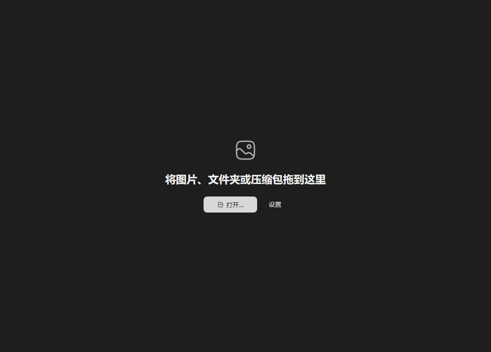
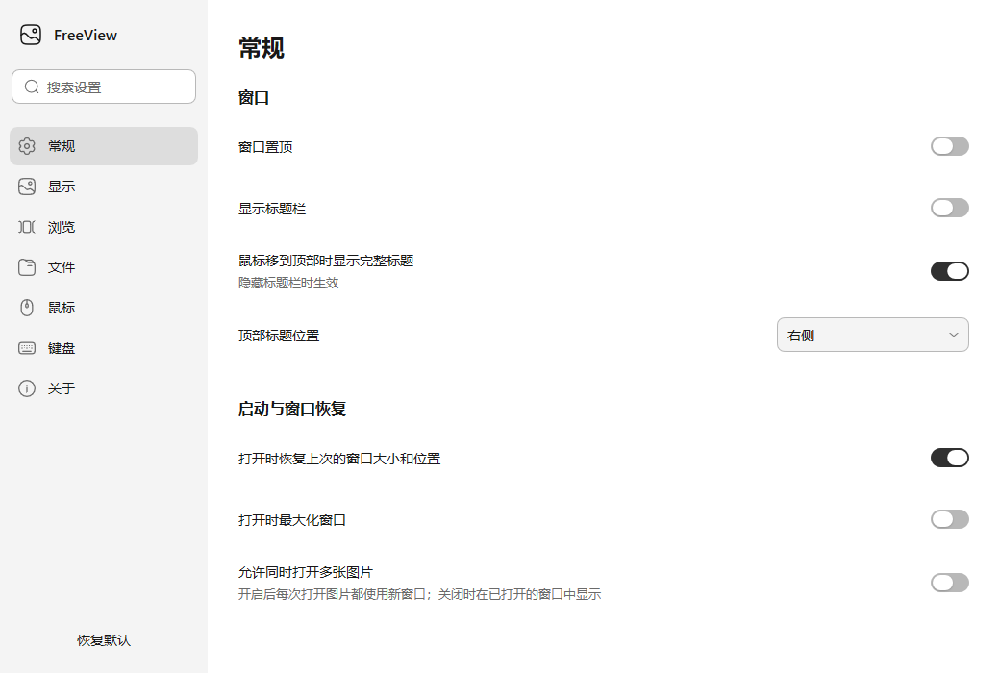

# FreeView 界面设计规范

本文件是 FreeView 自绘界面的共同基准。修改界面前先读本文件，再检查实际组件。界面与文档在同一次改动中同步；不得在单个页面另建一套色彩、字号或间距。

## 设计目标与边界

图片是主内容。默认看图窗口不增加常驻工具栏、侧栏或装饰。常用功能继续通过现有鼠标绑定、快捷键和右键菜单访问。保持 qView 的简洁和 Honeyview 的直接操作。

本次采用统一视觉规范和既有 nsgo 原生组件，在现有功能入口内改进布局。仅换色不能消除当前组件之间的差异；增加完整常驻工作台会占用图片空间，因此不采用这两种方案。

应用界面使用中性色，以字重、字号、对齐和留白表达层级。没有渐变、装饰动效或多层卡片。风险、适用条件和输入规则属于必要信息，保留短句；删除页面副标题和重复解释。

Windows 文件选择、系统菜单、文件属性、确认与更新提示使用系统窗口，遵循系统外观。应用不复制或重绘这些系统界面。

## 共同规则

具体颜色、字号与共享表面样式以 `cmd/freeview/design.go` 为代码入口。下表尺寸单位是 nsgo 逻辑点，在 Windows 100% 缩放下等于像素，其他缩放由系统换算。

| 对象 | 浅色 | 深色 |
| --- | --- | --- |
| 页面 | `#FFFFFF` | `#202020` |
| 侧栏 | `#F4F4F4` | `#282828` |
| 主文字 | `#181818` | `#F0F0F0` |
| 次要文字 | `#6A6A6A` | `#B0B0B0` |
| 控件边框 | `#B8B8B8` | `#666666` |
| 强调填充 | `#303030` | `#D8D8D8` |
| 强调上的文字 | `#FFFFFF` | `#181818` |

看图画布固定 `#1E1E1E`。图片上的浮层固定采用深色体系，不随照片或系统主题变化。品牌图标和图片内容不属于界面配色限制；危险操作保留 nsgo 的语义色。

| 对象 | 字号 / 行高 | 字重 |
| --- | --- | --- |
| 页面标题、空白页标题 | 24 / 32 | Semibold |
| 分组标题、面板标题 | 16 / 24 | Semibold |
| 正文、标签、控件 | 14 / 20 | Regular |
| 辅助信息、快捷键 | 13 / 20 | Regular |

字体使用系统默认字体和中文回退，不打包字体。间距使用 4 的倍数：4、8、12、16、24、32。控件圆角 8，菜单和提示 12，重命名面板 16。边线宽度 1–2 不属于间距。圆形开关、系统窗口和 nsgo 内部行为控件保留原生形状。

## 页面与组件

### 主窗口与空白页

主窗口保留无标题栏、顶部拖动区、全屏和标题栏设置。空白页只提供一个明确的打开操作和设置入口，拖入图片、文件夹、压缩包的操作用一条主文案表达，不堆叠快捷键说明。按钮至少 36 高，窄窗口文字可以换行。

### 设置

设置窗口默认 1040 × 700，最小 820 × 560。左侧固定 216，包含应用名、搜索、七个分类和底部恢复默认。右侧内容左右留白 32，最大宽度 760。页面只有一个纵向滚动区。

七个分类固定为常规、显示、浏览、文件、鼠标、键盘、关于。每组使用标题和留白分隔，表单不放入带底色的卡片，不为每行画分割线。普通行最低 64 高，标题和必要说明位于左侧，控件右对齐。路径单独占一行，按钮在下一行。快捷键输入与录制按钮放在标签下，避免窄窗口挤压操作名称。

搜索遍历同一份分类数据，结果保留分类与分组名称。切换分类清空搜索并回到页顶。修改设置立即保存且不关闭窗口；恢复默认继续要求确认。关于页保留版本、仓库、反馈、更新和全部许可入口。

### 菜单

右键与自定义“显示菜单”绑定打开同一个深色菜单。菜单统一内边距 8、圆角 12、最小宽度 256，文字 14，行高至少 32。快捷键右对齐，禁用、勾选和键盘焦点均可见。

保持现有命令及直接开关入口。菜单超过窗口可用高度时滚动，不挤小文字。悬停开启延迟 160 ms，已有子菜单时切换或关闭延迟 240 ms。安全三角区使用父项上的鼠标位置和子菜单近侧上下角，左右展开均适用；在该区域额外保留最多 600 ms，进入子菜单取消待切换动作。`menu_intent.go` 只补充 nsgo 缺少的悬停意图判断，定位、键盘和关闭行为继续由 nsgo 处理。

### 图片信息与其他浮层

图片信息、悬停标题、操作反馈采用相同的深色表面、文字和圆角。外边距 16，内部留白 12/16。信息过长允许滚动；反馈最大宽度受窗口约束。缩略图打开时，底部提示、重命名和鸟瞰图让出缩略图区域。

缩略图带高 96，单元宽 80，图片框 72 × 72，间隔 8，圆角 8。当前图片使用清晰的浅色描边，其余缩略图使用弱描边。缩略图默认关闭；通过命令或快捷键开启时立即显示，可以 Tab 聚焦并按 Enter/空格选择图片。启用后仍支持底部悬停显示。鸟瞰图保留当前视口矩形和点击定位，外框圆角 8。

重命名面板最大宽度 460，圆角 16，内边距 24，输入框 36 高。文件扩展名的保留规则属于必要说明。取消和确认在右下方，Enter 确认，Esc 取消。

## 交互与性能

- 保留用户设置与绑定，不用视觉更新改写默认行为
- 控件必须有可访问名称和可见键盘焦点，辅助操作不能只允许鼠标发现
- 复用 nsgo 的菜单、输入、选择与开关行为；本项目只统一样式和组合
- 交互过渡限于必要反馈，目标 150–250 ms，不做悬停上浮或放大
- UI 改动不向图片首屏路径加入像素解码、缩略图、色彩转换或网络请求
- 图片后台任务与目录缩略图任务保持各自生命周期

## 后续对齐与验收

新增界面先选择已有表面、文字层级与间距。若确实需要新规则，在本文件和共享实现中同步定义，并说明适用范围，避免只在局部硬编码。

每次界面修改至少检查：浅色和深色、中英文、设置最小窗口与默认窗口、空白页和已打开图片、菜单子级、长路径与长文字、键盘操作。使用真实生产组件做布局检查，并通过 `tools/deskrun` 在私有桌面查看真实窗口，不在用户桌面验收。

## 视觉参照

以下图片来自本项目真实 Windows 窗口，更新对应页面时一并核对；示意图不能代替这些实际画面。

## 2026-11-28 验证与依赖记录

- 官方下载列表确认 Go 1.27.4 为稳定版本，与当前工具链一致
- 已尝试官方正式版 nsgo 0.4.0（提交 `13e8823a46791ae47042dd20049b8b720442d5e3`），完成编译后在私有桌面复现切换键盘设置页崩溃，两次复现均定位到 `internal/platform/windows/damage.go:417`，`painter.pushAreas` 在绘制区域为空时访问 `p.areas[0]`
- 同一份应用改动使用 nsgo 0.3.4 完成七页设置切换和关闭窗口检查，因此暂时保留锁定的 0.3.4，没有采用浮动源码或修改依赖缓存。后续稳定版修复后重新运行相同验收再升级
- 布局测试覆盖中英文 × 明暗主题，在 820 × 560 设置窗口中检查七个分类的横向边界、输入与录制按钮的位置及搜索
- 私有桌面实测浅色中文与深色英文、1040 × 700 和 820 × 560 设置窗口、320 × 240 空白页、图片信息、重命名与缩略图共存、子菜单、关于页链接等待期间响应
- 子菜单延时与左右安全三角区由真实生产菜单的鼠标事件测试覆盖；缩略图的 Tab/Enter 访问、原有鼠标和键盘绑定仍由行为测试覆盖
- 使用预先编译的新旧程序、同一张 1600 × 1000 PNG，在没有并行构建或测试时交替各运行 5 次；首图时间旧版为 435/388/396/421/470 ms，新版为 421/395/442/405/541 ms，中位数均为 421 ms。这是本机热缓存样本，不代表所有格式或冷启动性能
- 内部模块测试、`nsgo check` 与 40 项应用行为测试通过

依赖核对来源：[Go 官方下载列表](https://go.dev/dl/?mode=json)、[nsgo 0.4.0 正式 Release](https://github.com/nsgo-dev/nsgo/releases/tag/v0.4.0)。本次验证不代表其他 Windows 版本或全部显示缩放比例已测试。
